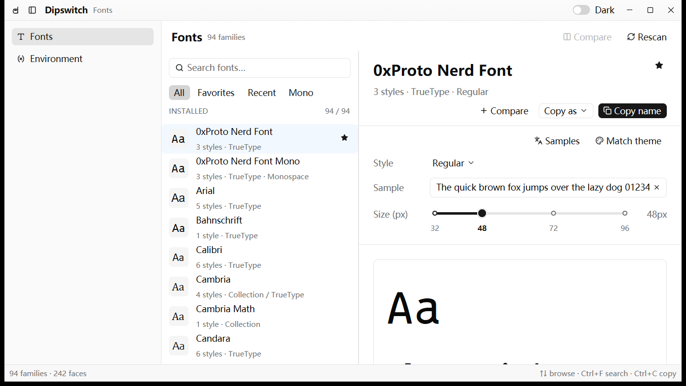

# dipswitch

个人本机控制台。基于 **GPUI Kit 0.8** 的原生桌面应用（非 Electron），左侧固定导航 + 右侧模块内容区。名字取自**拨码开关（DIP switch）**：一排开关集中在一个面板上，拨过去能拨回来——这就是本应用对每台机器做的事。

目前有三个模块：

- **Fonts** — 已安装字体的浏览、face 级预览、对比与一键复制；
- **Environment** — 用户级环境变量的读取/编辑，以及自定义分组的「一键启用 / 停用还原」；
- **Traffic** — 导入浏览器 HAR 与 Charles 会话，按请求查看头部、正文与耗时。

所有数据都存在本地 SQLite 库里：无账户、无云同步、无遥测、无后台进程。以 Windows 为主要目标平台，其他平台按只读/进程级降级。



## 功能

### 外壳

- **左侧导航**：`Fonts` / `Environment` 两个目的地，选中态是行自身的填充高亮（不是左侧色条）。导航可折叠成图标宽度，折叠状态与上次停留的模块都会落库，重启后回到原样。
- **键盘路径**：`Alt+1` Fonts、`Alt+2` Environment、`Ctrl/Cmd+B` 折叠导航。
- **标题栏**：自绘（隐藏系统标题栏），只放窗口装饰、当前模块名与全局 Dark 开关；模块自己的命令留在模块工具栏里。
- **状态栏**：由外壳统一绘制，左侧是当前模块的计数，右侧是当前模块的键盘提示。
- **模块常驻**：切走的模块视图实体不销毁，切回来是即时的，不重新扫描、不丢状态。

### Fonts 模块

- **按 family 浏览**：扫描系统字体，按 family 聚合，显示 face 数量、格式与等宽标记；字母序排列。字体名统一用界面字体渲染（图标字体没有拉丁字形，用自身字形渲染会变成一排豆腐块），`Aa` 缩略图与预览画布仍然用字体本身。
- **搜索**：按 family 名过滤，大小写不敏感；搜索框支持清空。
- **face 级预览**：选择 Bold / Italic / Light 等具体 face，预览、复制和元信息都针对当前 face；默认优先 Regular。
- **Copy as**：一键复制 family 名，或从下拉菜单复制 `Family + style`、PostScript 名、CSS 规则。
- **收藏 / 最近 / 筛选**：星标收藏 family；最近打开自动记录；支持 All / Favorites / Recent / Mono 四种筛选。
- **预览画布**：示例文本可在 Latin / 中文 / Code / Numbers 间切换；画布底色支持 Match theme / Light / Dark。
- **字号滑杆**：32 / 48 / 72 / 96 为刻度点，拖动连续预览，松手吸附到最近的点。
- **字体对比**：固定 2–4 个 family+face，同示例、同字号、同底色并排比较。
- **模块内快捷键**：`Ctrl/Cmd+F` 聚焦搜索，`Enter` 进入列表，`↑/↓` 浏览，`Ctrl/Cmd+R` 重新扫描，`Ctrl/Cmd+C` 复制。

### Traffic 模块

- **导入四种抓包文件**：浏览器 / DevTools 导出的 HAR（JSON）、Charles 的 JSON Session（`.chlsj`）、XML Session（`.chls`），以及 Charles 的二进制 Session（`.chls`，Java 对象序列化流）。**同名 `.chls` 有两种编码**，所以格式按内容嗅探（`{` / `[` / `<` / `AC ED`），扩展名只用于提示，不改判。文件读取与解析在后台线程，导入大文件不会卡住界面（实测 5.8 MB / 309 条约 0.1 s）。
- **两种导入入口**：工具栏 `Import…` 打开系统文件对话框，默认过滤 `*.har;*.chls;*.chlsj;*.xml`；也可以把文件直接拖进 Traffic 内容区（空白页或已有会话上都可以替换导入）。
- **请求表**：Status / Method / Path / Size / Time 五列，路径只显示 path（query 参数在详情里看，不把长查询串挤进列表）；`Time` 是请求开始的时刻，按**本机时区**显示，和 Charles / 浏览器的读数一致；状态码按 2xx / 3xx / 4xx / 5xx 分色，Charles 的失败会话显示 `Failed` 并保留原因。表格是虚拟列表，滚动句柄在多次渲染之间复用，几万条也只渲染可见行。**列宽可拖拽**（每个表头右缘），只在本次会话有效，不落库；Path 默认吃掉整行宽度，窗口变窄时允许收缩。
- **过滤**：搜索框按 URL、方法、状态码、主机名或失败原因过滤；搜索框下面是一行**状态类 chip**（`All / 2xx / 3xx / 4xx / 5xx / Failed`），每个 chip 后面带当前命中数，点一下只看那一类。过滤在数据源层做，虚拟列表的高度跟着过滤结果重算；结果计数显示在右上角。
- **详情浮层**：**默认不打开**，双击某条请求才展开。宽窗口（≥ 1100px）从右侧展开（宽 560px），窄窗口（< 1100px）改成**底部通栏**（高 420px，请求在左、响应在右并排），列表不再被盖住。浮层不参与列表宽度分配，打开/关闭都不会压缩列表列宽，覆盖的那块区域也不再接收鼠标事件（在里面滚轮不会带着列表滚，被盖住的行点不到）。已经打开时，单击别的行直接切换内容；`Esc` 或浮层右上角的关闭按钮收起。
- **详情分请求段与响应段**：请求段与响应段上下（窄窗口时左右）各成一段，各带自己的标签栏、各自独立滚动。请求段的标签是 Overview / Params (n) / Headers (n) / Body，右端挂方法徽标；响应段的标签是 Headers (n) / Body，右端挂协议与状态码徽标。标签按内容出现：没有正文就没有 Body，没有查询串就没有 Params。
- **URL 单独一行**：浮层顶部是这次请求的完整 URL，等宽体、链接色、**不截断**（长了就折行），点它交给系统默认浏览器打开，右边一个复制按钮。URL 是这次请求的身份，其余字段都能由它推出。
- **浮层里翻上一条 / 下一条**：浮层头部有上一条 / 下一条两个按钮，直接换到相邻请求，浮层不关、列表选中态跟着走。一份会话动辄几百条，靠回列表点行翻要几十次往返。
- **Overview 是一张事实表**：状态 / 方法 / 协议 / 类型 / 大小 / 耗时 / 起始时间 / 远端地址 / 参数数量，起始时间带本机时区偏移；「基本」与「来源」两组，后者可折叠。
- **详情用表格读**：每个分区是一条表头带（标题 + 计数 + 整段复制），下面一行一条记录，与主表同一套底色、单元格、分隔线与悬停；键列固定宽度，值列吃掉剩余宽度并单行截断，**每行末尾一个复制按钮**取完整值（长 cookie / token 不换行也不丢）。JSON Tree 的展开态同样落在这两列上，缩进进键列，值列保持对齐。
- **正文格式化**：JSON 提供 Pretty / Tree / Raw / Hex，Pretty 按语法着色（成员名用前景色，字符串 / 数字 / 布尔 / null 沿用 Tree 的那套主题色），Tree 按节点展开（默认只铺第一层）；`application/x-www-form-urlencoded` 提供 Form 键值表与 Raw / Hex；其他类型显示 Raw / Hex。**二进制正文有 Hex 兜底**（偏移 + 两列 16 进制 + ASCII 侧栏），不再是一片空白。预览只保留 64 KiB，截断时会写明实际展示长度。
- **压缩正文**：Charles 二进制会话保存的是线上原始字节，`Content-Encoding: gzip / deflate` 的响应会先解压再展示（解压上限 64 MiB，防压缩炸弹）；解不开或本来就是二进制的只标大小，不展示乱码。
- **边界**：单个文件 ≤ 256 MB、最多导入 50,000 条请求；单个正文预览 ≤ 64 KiB、整份日志正文预览合计 ≤ 32 MiB。超限会如实提示，不静默截断。Charles 的失败会话保留异常原文（如 TLS 握手失败、DNS 解析失败），显示在 Overview 的 Status 行。
- **不落库**：抓包内容只在本次会话里，关闭应用即释放；配置库里只保存长期偏好，不保存报文。
- **命令行打开**：`dipswitch session.har`（或 `.chls` / `.chlsj`）直接进入 Traffic 并加载该文件。
- **模块内快捷键**：`Ctrl/Cmd+O` 导入，`Ctrl/Cmd+F` 聚焦过滤框；模块切换是 `Alt+3`。

### Environment 模块

- **读取用户级环境变量**：Windows 下读 `HKCU\Environment`，保留 `REG_SZ` / `REG_EXPAND_SZ` / `REG_MULTI_SZ` 三种类型；`REG_MULTI_SZ` 只读展示（分隔符本身是数据，直接编辑会被改坏）。系统变量表头是 Variable / Value / Type / Source / Actions；分组内变量表把 Source 换成 State（`Overridden` 表明被更晚启用的分组覆盖）。
- **行交互**：鼠标悬停整行高亮；行内图标按钮的悬停底色比整行再深一级（ghost 按钮的 `accent` 与 `table_hover` 同色，直接用会看不出反馈）；双击行（key / value / type / source 区域）直接打开编辑弹窗——被分组接管的 key 打开的是分组里那一条。操作列是行的兄弟元素，在按钮上双击不会误触发行编辑。
- **增删改**：`Add variable` 新建；行菜单里 `Edit variable` 改值、`Delete from user environment` 删除（带确认对话框，说明后果）。写完同步当前进程环境并广播 `WM_SETTINGCHANGE`，新启动的进程即可看到。
- **过滤与复制**：按 key 或 value 过滤；每行可复制值。
- **自定义分组**：`New group` 建组（名称 + 备注），组内可增删改变量；行上的开关一键启用/停用整组。
- **同名 key 的覆盖规则**：启用的分组按**启用先后**排优先级，**最后启用的那一层覆盖**同名 key。分组详情里会标出「有几个变量被更晚启用的分组覆盖」。
- **停用后恢复**：某个 key 第一次被分组接管时，把它当时的原值（含「原本不存在」这一状态）记入基线。停用分组后重新解析——还有别的分组接管就生效下一层，没有分组接管就恢复基线；基线是「原本不存在」就把这个变量删掉。
- **不骗人**：被启用分组接管的 key，在系统视图里禁止直接编辑/删除，行菜单会把你引去编辑分组里的那一条（否则你写的值会被分组立刻覆盖，界面却显示已保存）。
- **变更流水**：每次启用/停用/删除都会记一条 `env_event`，分组详情底部显示最近几条，可单独清空。
- **非 Windows 平台**：写入落点退化为「当前进程环境」，界面上的 scope 文案会如实说明，不会假装已经持久化。

## 图标

全部界面图标来自**同一个家族**（Lucide，24×24 网格、2px 描边、圆头端点），所以风格天然统一；组件自带的窗口按钮也是 Lucide，不需要额外对齐。

- **调用点只说语义，不说图形**：`src/icon.rs` 的 `AppIcon` 是应用内图标的唯一词汇表，变体叫 `Delete`、`Edit`、`NewGroup`、`Recent`，不叫 `Trash`、`Pencil`。全项目 50+ 处调用点没有一处直接写 `IconName`——`icon.rs` 之外可以 grep 验证为零。
- **改指向只动一行**：每个语义在 `AppIcon::target()` 里指向一个 `Target`——`Builtin(IconName)` 用 Lucide 图形，`Custom(&'static [u8])` 用应用自带的 SVG 字节（集中在 `icon::custom`）。以后想把 `Delete` 从内置垃圾桶换成自己画的形状，只改那一行，调用点和其余图标都不受影响。`AppIcon::Brand`（标题栏）与 `AppIcon::Monospace`（自绘等宽标）已经在走这条通路，所以它不是纸面设计。
- **不受组件层 106 个的限制**：`gpui_component::IconName` 只是 `gpui_kit_assets::IconName`（1,830 个）的兼容子集，而组件 API 收的是 `impl Into<Icon>`、`Icon` 对任何实现 `IconNamed` 的枚举有 blanket `From`——所以全量目录都能用。代价是共享枚举给出的是**路径**，默认包只嵌了那 106 个的字节，因此本应用用到的子集之外图形由 `icon_assets!` 点名嵌入（当前 11 个，约 +20 KiB）。
- **漏登记会立刻失败**：`icon::tests::every_app_icon_resolves_to_real_svg` 逐个断言每个语义图标取得到真实 SVG 字节，两类指向都覆盖（内置的查注册后的资产源，自定义的查内嵌内容）。用了没登记的图形不会编译报错，只会在界面上画出一片空白，所以必须在测试里拦住。
- **品牌标**：一枚字母 `d`，碗部是一格打到 ON 的开关。任务栏/文件图标用 `assets/brand.svg`（全彩带底板），应用内用 `assets/brand-mark.svg`（单色描边版，原因见「实现要点」）；后者经 `AppIcon::Brand` 进出，并有 `custom_targets_are_mask_safe` 拦住「把带底板的版本拿进应用内用」。
- 语义分配的取舍：导航折叠按**状态给方向**（展开态 `PanelLeftClose`、折叠态 `PanelLeftOpen`），图标能预告点下去会发生什么；`More` 用竖排三点，因为它挂在横向排布的表格行上；`Compare` 是两栏并排、`Recent` 是时钟（与「重新扫描」的箭头区分）、`Edit` 是铅笔、`Delete` 是垃圾桶、`NewGroup` 是新建文件夹、`Environment` 是 `Variable`；警告（`TriangleAlert`）与错误（`CircleAlert`）分形分色。
- **后果等级进表，颜色归主题**：`AppIcon::role()` 回答「这个操作有多危险」（`Neutral` / `Danger` / `Warning`），`AppIcon::role_color(cx)` 是**唯一**把角色翻译成主题色的地方（`icon_in(cx)` 与 `ui::*_icon_button` 都走它）。表里**不存色值**——主题有浅/深两套（未来可能更多），存颜色就变成 `图标 × 主题` 矩阵，而 `theme().danger` 本身就是这个矩阵的解，浅色深色自动跟随。删除是 `Danger`；从对比集合移出一项刻意保持 `Neutral`——如果可逆操作也是红的，红就不再说明任何事。`only_delete_is_dangerous` 用「危险图标清单必须恰好是 `[Delete]`」把这条钉住，新增图标误标 Danger 会直接红。
- 落点：两处删除确认框用 `ok_variant(ButtonVariant::Danger)`；行菜单给破坏项加分隔线 + danger 色垃圾桶图标；工具栏图标按钮由 `ui::row_icon_button` / `ui::icon_button` 统一把危险色设成前景色（换成 `.danger()` 会变成实心色块，在工具栏里太重）。
- 已知限制：`PopupMenuItem` 只有 `.icon()` 与 `.disabled()`，**没有 danger API**，图标是当前唯一可用通道；另外 `From<AppIcon> for Icon` 拿不到 `cx`，所以只有显式走 `icon_in(cx)` 或 `ui::*_icon_button` 的调用点才带色，`.icon(AppIcon::Delete)` 仍是形状级。
- **`Monospace` 是第一个因「内置目录表达不出」而自绘的操作图标**：Lucide 里没有「等宽」的直译图形（`Braces` 表示代码、`SquareAsterisk` 与 `Binary` 都不对），所以画了 `assets/icon-mono.svg`——两个等宽字符格，左格放宽字符 M、右格放窄字符 `|`，格同宽即等宽。它经 `AppIcon::Monospace → Target::Custom` 进入，与品牌标共用同一张指向表。

## 运行

```bash
cargo run
# 打开一份抓包会话（HAR / .chlsj / .chls）
cargo run -- session.har
```

要求 Rust 1.85+（edition 2024）。Windows 首次构建需要 Windows SDK（SQLite 走 `bundled`，由 `cc` 现场编译 amalgamation）；Linux 需要 X11/Wayland 开发库。

`Cargo.toml` 里给 `dev` profile 的依赖单独开了 `opt-level = 3`（本 crate 用 O1）。GPUI 的布局与绘制在未优化构建下会有明显的交互滞后，这个设置让 `cargo run` 也保持跟手；代价是首次构建更久。

依赖基线：

```text
gpui-kit 0.8.0
├─ gpui-pre 0.3.9        ← GPUI 本体（Zed gpui 快照）
├─ gpui-component 0.8.0  ← 控件库（Sidebar / Dialog / Table / Switch …）
└─ gpui-kit-assets       ← 默认图标（共享枚举有 1,830 个，但默认只嵌了组件层用到的那 106 个字节）
fontdb 0.24              ← 系统字体枚举
quick-xml 0.42           ← Charles XML 会话解析（.chls 的文本编码）
base64 0.22              ← HAR / Charles 里编码过的正文
java-serialization 0.1   ← Charles 二进制会话（.chls 的对象序列化流，MIT）
flate2 1                 ← 解压 gzip / deflate 正文
chrono 0.4 (clock)       ← 把抓包时刻按本机时区渲染；gpui 依赖树里本来就有这个版本，
                           所以依赖树里没有任何新增 crate
rusqlite 0.40 (bundled)  ← 本地配置库
winreg 0.56              ← HKCU\Environment 读写（仅 Windows）
rfd 0.17                 ← 带扩展名过滤的文件对话框（仅 Windows；gpui 的 PathPromptOptions 没有过滤项）
windows-sys 0.60         ← WM_SETTINGCHANGE 广播（仅 Windows）
serde / serde_json / dirs

# 仅 Windows 的 build-dependency
embed-resource 3.0.12    ← 编译 .rc 进 exe（图标 + 版本信息）；gpui-pre 本来就依赖它，
                           所以依赖树里没有任何新增 crate
```

## 结构

```text
build.rs           Windows 下生成 .rc 并编进 exe 资源：图标 + 版本信息（与 Zed 同款做法）
assets/
├─ brand.svg       应用图标源：全彩带底板，喂 .ico
├─ brand-mark.svg  应用内品牌标：同一枚 d，按 Lucide 描边语言重画（见「图标」）
├─ icon-mono.svg   自绘的等宽标记：Lucide 目录里没有「等宽」的直译图形
└─ app.ico         提前生成好、随仓库同步的 7 档图标（16/24/32/48/64/128/256）
src/
├─ lib.rs            库目标：让视图与测试共用同一份真实实现
├─ main.rs           二进制入口：初始化、注册资产源、开库、绑键、建窗口
├─ shell.rs          窗口外壳：标题栏 + 左侧导航 + 模块路由 + 状态栏
├─ icon.rs           全局图标出口：AppIcon 语义 → Lucide 图形 + SVG 注册 + 品牌标
├─ ui.rs             界面共享语汇：表格列宽 / 表头 / 单元格 / 图标按钮 / 计数文案
├─ fonts_view.rs     Fonts 模块（FontsModule + FontListDelegate + 对比视图）
├─ environment_view.rs  Environment 模块（变量表 / 分组主从 / 弹窗表单）
├─ capture.rs        抓包解析：HAR / Charles JSON / Charles XML → 统一模型（纯逻辑）
├─ capture/chls.rs   Charles 二进制 Session（Java 序列化流）→ 同一模型
├─ capture/tests.rs  文本格式的夹具与解析断言
├─ capture/fixtures/minimal.chls  合成的二进制会话夹具（2.5 KB，无真实报文）
├─ highlight.rs      JSON 语法分词：给出「哪一段是什么」，颜色由视图决定（纯逻辑）
├─ traffic_view.rs   Traffic 模块（导入 / 拖拽 / 虚拟列表 / 请求段·响应段双分区详情 / 正文格式化）
├─ env_model.rs      分层解析：谁覆盖谁、基线何时记录、停用恢复什么（纯逻辑）
├─ env_service.rs    把解析结果落到环境与数据库（能力缝 EnvBackend）
├─ system_env.rs     平台适配：HKCU\Environment 读写 + 广播 / 进程环境回退
├─ store.rs          SQLite 配置库：schema、偏好、分组、基线、流水
├─ settings.rs       Settings Global + 旧 JSON 的一次性导入
├─ fonts.rs          fontdb 扫描与 family/face 模型（不依赖 GPUI）
└─ size_slider.rs    带预设刻度与松手吸附的字号滑杆
examples/canvas_probe.rs 自绘画布探针：节点用 absolute div、连线用 canvas + PathBuilder
```

本仓库只有交付物与应用源码；图标生成与窗口截图这类开发脚本作为维护者工具单独维护，不在仓库内——构建不依赖它们，`assets/app.ico` 是提前生成好并提交进来的产物。

状态所有权：

- `Dipswitch`（外壳）只拥有「当前模块」「导航是否折叠」和两个模块实体；模块自己拥有数据与交互状态。
- `EnvironmentModule` 持有的是**快照**（系统变量、分组、组内变量、来源诊断），每次操作后整体重载，视图不维护第二份真相。
- `env_model::plan` 是覆盖/恢复规则的唯一实现；`env_service` 只负责喂数据和落盘；视图不参与判断。
- `FontListDelegate` 仍是字体列表的唯一数据源；`Settings` Global 存长期偏好，退出时统一落库。
- `TrafficModule` 持有本次会话唯一的一份 `CaptureLog`；过滤结果只存下标，虚拟列表按需渲染；抓包内容不进 `Settings`、不写 SQLite。

## 实现要点

**分层解析。** `build_layers()` 把启用的分组按 `enabled_seq` 升序排成层，`plan()` 对每个被接管的 key 取最高层为生效值，并对「有基线但已无分组接管」的 key 生成恢复步骤。启用＝`enabled_seq = max+1`，停用＝清空——所以「最后启用者覆盖」和「退回下一层」是同一套规则的两个方向，不需要额外记录每组的快照。写入失败的 key **不会**释放基线，下次操作仍会重试。

**基线保真。** 基线表存 `value`（可为 NULL）+ `kind`，因此 `%VAR%` 型值和「本来没有这个变量」都能原样还原。`REG_MULTI_SZ` 的内部表示用 `\0` 连接各项，展示时才用 `; ` 分隔，写回按项重新编码。

**能力缝。** `EnvBackend`（read / write / remove）让「启用 → 覆盖 → 停用 → 恢复」这条主链路可以用内存假后端做端到端测试，不碰真实注册表；真实后端 `SystemEnvBackend` 只在生产路径上出现。

**标题栏里的控件要自己拦下鼠标按下。** Windows 把自绘标题栏的整条内容声明成 `HTCAPTION` 拖拽区：鼠标按下会交给系统窗口移动的模态循环，控件只收到按下、收不到抬起，`on_click` 永远不触发。所以标题栏里的抽屉按钮和主题开关都在自己的按下事件里 `stop_propagation()`（`shell::intercept_title_bar_press`），平台层就不会把这次按下交出去；其余空白区域仍然交给系统拖动。

**界面规则有唯一出口。** 表格列宽、`cell` / `table_header`、等宽字体、行内图标按钮与计数文案都在 `src/ui.rs`；视图里不写列宽数字，也不手拼 `Button::new(..).ghost().icon(..)`。行内按钮不用 ghost 悬停是因为组件给 ghost 的 `accent` 与表格行的 `table_hover` 同色（浅色同为 `#f5f5f5`），指针移上去看不出任何变化；`ui::row_icon_button` 改用 `ButtonCustomVariant`，悬停取更深的 `secondary`，并把 `AppIcon::role()` 的危险色直接设成前景色。完整的界面条文（颜色、排版、状态矩阵、文案、检查清单）维护在项目之外的设计文档里，不外发；仓库内的硬约束以 `src/ui.rs` 为准。

**二进制 `.chls` 是 Java 对象序列化流。** Charles 的 Session File 有两种编码：老的 XML 和新的 Java `ObjectOutputStream` 二进制。二进制流自带类描述，所以解析不依赖 Charles 版本号：先按 `java-serialization` 读出对象图，再从 `Session.children → Host/Path → Transaction` 里按字段名取 `scheme`（Charles 把方法存在这个字段里）、`protocol`、`host`、`file`、`requestHeader/responseHeader`（`HttpFields` 的值写在自定义注解里，HTTP/2 的状态在 `:status` 伪头，HTTP/1 在首行）、`startTime/endTime`、`requestBody/responseBody` 与 `exception`。视图层完全复用其他格式的 `Entry`，所以四种来源的表格与详情行为一致。

**抓包解析只做「文件 → 模型」。** `capture.rs` 不依赖 GPUI：HAR 与 Charles JSON 走 serde，Charles XML 走 quick-xml 的事件流（按本地名匹配，兼容 `cha:` 前缀；`<body>` 的 base64、实体引用、CDATA 都覆盖）。正文只保留预览并共享一份预算，避免一份 HAR 里几百个大响应把内存吃光；`Entry` 里同时留完整大小与是否截断，界面据此如实说明。文件大小与请求数都有硬上限，超限提示而不是静默丢弃。`Entry.path` 只存路径，查询串单独放在 `query`：列表按路径对齐，参数表从 `query` 解出来，两处都不需要再切 URL。

**详情用同一套表格语汇，不引第三方表格控件。** 分区的表头带就是 `ui::table_header`，行用 `ui::cell`，键列 `ui::DETAIL_KEY_COLUMN`、行内复制列 `ui::DETAIL_ACTION_COLUMN` 都是常量；这样详情的表与主表在底色、单元格内边距、分隔线、悬停上必然一致。没有用组件库的 `DataTable`：它要求 `Entity<TableState>`、固定像素列宽（没有弹性列）、自带 `DataTable` 键上下文会抢上下键与 PageUp，在一个 560px 的浮层里得不偿失。

**Pretty 的高亮是自己分词，不是 tree-sitter。** gpui-component 的 `highlighter` 模块在默认特性下是空实现（`wasm_stub`，`styles()` 只返回一段默认样式），打开它的 `tree-sitter` 特性要给依赖树加 tree-sitter 运行时和一次 C 编译，而这里只需要 JSON 一种语言。所以 `highlight.rs` 手写一个 JSON 扫描器返回 `(Range, Token)`，视图把 Token 映射成主题色后交给 `StyledText::with_highlights`。残缺输入（正文被截断）也在这条路上测掉了。

**Traffic 的列表与详情是两条独立的滚动链。** `v_virtual_list` 每次渲染都会新建 scroll handle，必须由视图持有一份并用 `.track_scroll()` 重新挂回去，否则滚一格、下一帧就弹回顶部；列表外面那层拖拽区必须是 flex 容器，普通 block 包裹层会掐断 `flex_1` 链，列表和详情都量成 0 高（这两个坑都实测过）。详情在宽窗口里是 `absolute` 定位的右侧浮层，不参与列表列宽分配：默认关闭，双击行打开，`Esc` 收起；打开时只覆盖列表右侧，不压缩任何列。窄窗口（< 1100px）改成底部通栏，请求在左、响应在右并排。列宽由模块持有并为每个表头画一条可拖的边界（`occlude` 保证压在相邻列上也能命中），会话结束即忘。详情分**请求段 / 响应段**两段，各段自带标签栏与独立滚动：请求段 Overview / Params (n) / Headers (n) / Body，响应段 Headers (n) / Body，标签按内容出现。Body 的 Pretty / Tree / Form / Raw / Hex 由 MIME + 内容决定，Tree 只铺第一层、按路径记录展开状态，换一条请求就清空。长 cookie / token 在头部与参数表里单行截断，否则没有断点的长串会把详情撑出面板。浮层根 `.occlude()`：GPUI 的滚轮分发会把命中路径上**所有**可滚动节点各自处理一遍，不声明遮挡就会「在浮层里滚、底下列表跟着滚」。

**并排的两段要显式 `items_stretch()`。** gpui-base 的 `h_flex()` 是 `flex_row().items_center()`——它在交叉轴上**居中**，不是拉伸。于是两段各自按内容高度居中：高的一段上下溢出被裁、低的一段悬在中间，两段都读不全。`v_flex()` 不装对齐（children 自然拉伸），所以上下堆叠那一版不受影响。窄窗口下请求 / 响应并排必须自己补 `items_stretch()`。

**时间只存绝对时刻，换算放在视图层。** 会话里的时间戳（二进制是 `java.util.Date` 的 epoch 毫秒，HAR / Charles JSON 自带偏移）统一成 RFC 3339 存进 `Entry.started`，界面再用 `chrono::Local` 渲染成本机时区——直接印 UTC 会比 Charles 的读数差一个时区。耗时口径跟 Charles：从请求开始写出（`requestBeginTime`）量到响应结束，不含建连那 1ms，缺字段才回落到事务起止。

**Charles 二进制会话存的是线上原始字节。** `responseBody` / `requestBody` 往往带着 `Content-Encoding: gzip` 或 `deflate`，展示前按头部解压（上限 64 MiB，防压缩炸弹）。解压后的前缀如果出现非法 UTF-8，说明它本身是二进制（或者编码头不可信），按二进制标注，不能把首个合法字节当正文——早期版本就是这样把 gzip 的 `0x1f` 显示成一片空白的。

**图标只用一个家族，语义名与图形名分开。** 见上面的「图标」。

**`Assets::load` 未命中返回 `Err`，不是 `Ok(None)`。** 所以组合资产源时自定义源必须在前、默认包兜底；反过来写并用 `?` 串联，会让默认图标全部加载失败（实测表现为运行期 panic）。

**`Icon` 这条路只输出 alpha 蒙版，所以没有彩色图标。** 根因在渲染器而不是组件层：`gpui_component::Icon` → `svg()` 元素 → `window.render_svg` → `SvgRenderer::render_alpha_mask`，那个函数栅格化后只保留 `p.alpha()`，RGB 当场丢弃，再用一个前景色填充。设计动机是合理的——图标要跟主题走（浅/深/强调/禁用态共用一份文件），且蒙版是 1 字节/像素、比 RGBA 省 4 倍纹理，同一蒙版可换色重绘而不必重新栅格化；Lucide 整套 `stroke="currentColor"` 的线性图标正是为这个模型准备的。

需要彩色时 GPUI 另有通路：`img()` 元素遇到 SVG 字节走的是 `render_single_frame` → `render_parsed`，返回完整 RGBA 的 `RenderImage`。代价是它不跟随主题色（深色模式要自己出第二版）、纹理 4 倍，而且不是 `Icon`，进不了 `Button::icon(...)` 这类只收 `impl Into<Icon>` 的槽位。所以本项目约定：**操作图标一律单色描边**（应用内品牌标也因此重画成 `assets/brand-mark.svg`，带底板的全彩版 `assets/brand.svg` 只用于 exe 图标——实测放进标题栏会渲染成一个实心方块）；真要彩色，走 `img()`，不要塞进 `AppIcon` 指向表。

**Windows 的窗口图标只能走资源编译。** `WindowOptions.icon` 标注 X11 only，GPUI 在 Windows 下也不暴露 HWND，所以运行期 `WM_SETICON` 这条路不通。做法照搬 Zed 的 `crates/windows_resources`：`build.rs` 在 `OUT_DIR` 里**生成** `.rc`（`#pragma code_page(65001)` + `1 ICON` + `VERSIONINFO`），交给 `embed-resource` 编译。它自带 `KitsRoot10` → `vswhom` → `PATH` 的 `rc.exe` 发现链，支持 GNU 工具链走 `windres`，并认 `RC` / `RC_<target>` 覆盖；顺带把版本信息也写进文件属性。两点与 Zed 有意不同：**不写 manifest 行**——`gpui-pre` 自己的 build.rs 已经嵌了 `1 RT_MANIFEST`（实测产物含 `dpiAware`），再来一份同 ID 同类型就是自相冲突；**失败降级成 `cargo:warning`** 而不是 `unwrap()`——图标是观感项，缺 SDK 时也该构建出可用的 exe。

**资源生成不属于构建。** `build.rs` 只**消费**已提交的 `app.ico`，不生成它。把生成塞进构建等于让构建依赖 Python 加一个 SVG 光栅器，与「离线构建」的验收项冲突。所以 `assets/app.ico` 是**提前生成好、随仓库同步的产物**；改了 `assets/brand.svg` 之后要用维护者工具重新出图并提交，否则 exe 里还是旧图标而构建不会报错。

**交互路径上的落盘只提交一次。** `Settings::save` 把十几条偏好收进一个事务（`DipswitchStore::set_settings`），库本身跑 WAL + `synchronous = NORMAL`。默认 journal 下逐条提交在 Windows 上要 ~50 ms，整组一个事务后是 ~3 ms——否则每次切模块、点收藏都在这上面卡一下。

**持久化。** 配置库在 `%LOCALAPPDATA%\dipswitch\dipswitch.db`（Linux `~/.config/…`，macOS `~/Library/Application Support/…`）。schema：

```text
app_setting(key PK, value)                 偏好，一个 key 一行（appearance.* / fonts.* / window.* / dipswitch.*）
env_group(id PK, name UNIQUE, note, is_enabled, enabled_seq, created_at)
env_variable(id PK, group_id FK→env_group ON DELETE CASCADE, key, value, kind, UNIQUE(group_id, key))
env_baseline(key PK, value NULL, kind, captured_at)      接管前的原值，恢复依据
env_event(id PK, at, detail)                             启用/停用/覆盖/恢复流水
```

`PRAGMA user_version` 记 schema 版本，`foreign_keys = ON`。两次改名都带数据搬迁：旧 `font-manager/settings.json` 与旧 `workbench/workbench.db` 在第一次启动时各自导入一次，原文件保留不动，`app_setting` 里记下来源。环境变量分组的基线表是「停用后能否还原」的唯一依据，所以导入逻辑与 `Settings::load` 分开——测试不会因为机器上恰好有旧文件而拿到意外结果。

## 路线图

按「零风险高频 → 只读系统观察 → 提权写入」的顺序推进：

| 阶段 | 内容 |
|---|---|
| 已完成 | **Traffic**（HAR / Charles 导入与查看） |
| 下一步 | 模块规格表（新增模块只改一处）、schema 编号迁移、备份/还原点服务、只读命令执行 seam；然后上 **Toolbox**（JSON / 编码 / 哈希 / JWT / 时间戳） |
| 之后 | **Ports & Processes**（端口 → 进程 → 定位，结束进程需二次确认） |
| 更后 | **Hosts Manager**（分组切换 + 提权写入）、**SSH 配置**（只读解析 `~/.ssh/config`） |

明确不做：系统级管理（`HKLM`、服务、驱动、计划任务）、跨设备同步、云账户、插件市场、脚本沙箱、自动更新与代码签名。

## 验证

```text
cargo fmt --check              通过
cargo check --all-targets      通过
cargo clippy --all-targets     0 warning
cargo test                     84 passed + 1 ignored（真实注册表探针）
cargo build --release          通过

# 资源侧核对：rc.exe 把 PNG 型 ICO 条目的负载原样存进 RT_ICON，所以在 exe 里逐档搜
# 字节就是硬证据（别用 ExtractAssociatedIcon——它遇 PNG 压缩条目会返回 null）。
# 实测 debug 与 release 均为 7/7 图标条目 + gpui 的 RT_MANIFEST 仍在（含 dpiAware）。
```

自动化覆盖（`cargo test`）：

- **覆盖与恢复**：最后启用的分组赢；停用最高层退回下一层而不是直接跳回原值；停用最后一层恢复原值；分组新建的 key 在停用后被删除；删除已启用的分组会先还原它接管的东西；连续两次 `reconcile` 幂等（第二次不动任何值）。
- **基线**：首次接管记录原值（含「原本不存在」）；写入失败时保留基线以便重试；恢复完成后释放基线。
- **护栏**：被启用分组接管的 key 拒绝系统层直接编辑/删除，未接管的放行。
- **存储层**：分组同名唯一、组内 key 唯一、跨组同名允许、级联删除、`enabled_seq` 递增与清空、值类型按注册表名存取、流水倒序与清空。
- **偏好**：`Settings` 全字段往返 SQLite；空库回默认值；旧 JSON 能导入、坏 JSON 不炸且不落库。
- **图标指向完整性**：每个 `AppIcon` 都取得到真实 SVG 字节，内置与自定义两类指向都覆盖；`AppIcon::ALL` 覆盖全部变体，且没有两个语义图标意外共用同一内置图形；品牌标必须是描边 + `currentColor` 且不带 exe 底板色；危险等级清单必须恰好是 `[Delete]`（可逆操作保持中性色）。
- **界面语汇**：计数文案只在 1 时用单数（0 与 N 用复数），避免 “1 variables”。
- **抓包解析**：HAR 的 query / headers / postData 参数 / base64 正文；Charles JSON 的 URL 拼装、失败会话原因、非默认端口；Charles XML 的命名空间前缀、实体引用、CDATA、base64 二进制正文与默认端口省略；Charles 二进制会话的合成夹具（对象图、HTTP/1 first-line、HTTP/2 `:status`、时间与远端地址）；未知格式与 ZIP 归档给出可操作的错误；状态码分类与条目上限截断；路径与查询串拆分、百分号解码；gzip / deflate 解压与「标注了编码但解不开」的二进制分支；非法 UTF-8 不会被当成空白正文。
- **正文视图**：JSON 才有 Pretty / Tree，urlencoded 才有 Form；JSON 被截断时只提供 Raw；Tree 默认只铺第一层、按路径展开；Pretty 的缩进格式；非法 JSON 不冒充可格式化。
- **详情与筛选**：状态类过滤只命中自己那一类（2xx chip 不会漏掉 4xx）；Hex 转储有行数上限（一次最多 1024 行）；长 URL 在分隔符处折行而不是被截断；时间按本机时区渲染，认不出的时间戳原样显示而不是留白。
- **平台适配**：`REG_SZ` / `REG_EXPAND_SZ` / `REG_MULTI_SZ` 的字节级编解码往返（含 `%`、空格、分号），不支持的类型不会被当字符串读出。
- **真实注册表探针**（`cargo test -- --ignored`）：写一个 `DIPSWITCH_SELFTEST_PROBE` 探针 key → 读回校验类型与值 → 确认当前进程可见 → 删除并确认清走。默认不跑，因为它真的会动 `HKCU\Environment` 并广播一次 `WM_SETTINGCHANGE`。

手工验证（Windows，PostMessage 模拟真实点击 + PrintWindow 抓图）：

- 启动落在 Fonts 模块，标题栏、导航、状态栏、字体列表与预览均正常；
- 导航切到 Environment → 读到本机 `HKCU\Environment` 变量，scope 文案、表格列、Source/Actions 均正确；
- Groups 页签的空状态说明、`New group` 弹窗的字段与按钮渲染正确；
- Traffic 用 `dipswitch <har>` 启动：6 条请求的表格、状态分色、过滤（含 0 命中）、三个详情页签、base64 二进制正文提示都正常；Charles XML 会话的 `Charles XML` 来源与 `Failed` 失败行正常；深浅两套主题下的表格与正文可读；
- Traffic 右侧详情（Computer Use 实测）：默认关闭；单击只高亮、不打开；双击后浮层从右侧展开且列位置不变（列表宽度不被压缩）；`Esc` 与关闭按钮都能收起，已打开时单击别的行直接切换；列表滚轮可滚动多行且不弹回顶部；表头边界拖拽可改列宽（Status 与 Path 实测），重启后回到默认；Request 的 Query Parameters / Headers / Body 分区与 19 个头部完整显示；Response 的 gzip HTML 正文解压后可读，JSON 请求体的 Pretty / Tree / Raw 切换正常；系统文件对话框的过滤项显示为 `Capture logs (*.har;*.chls;*.chlsj;*.xml)`，选中文件后能完成导入；
- Traffic 时间与浮层滚动（Computer Use 实测，真实 Charles 二进制会话 309 条）：列表 `Time` 与详情 `Started` 的读数与 Charles 一致（`12:30:29` / `2026-10-26 12:30:29.883 +08:00`），耗时同为 `472 ms`；在浮层内滚滚轮只有详情内容动、列表保持原位，滚轮移到列表区域才滚动列表，浮层收起后列表仍占满宽度；
- Traffic 详情的表格与高亮（Computer Use 实测，真实 Charles 二进制会话 309 条，浅/深两套主题）：Overview / Query Parameters / Headers 都是「表头带 + 一行一条」的表格，表头带右侧整段复制、每行右侧单个复制，`Set-Cookie`、`canary` 这类长值单行截断不出格；JSON Tree 展开 `Credentials` 后子行缩进进键列、值列仍对齐；Pretty 的成员名、字符串、数字、布尔、null 分别着色，与 Tree 同一套颜色；
- Traffic 详情分段与筛选（Computer Use 实测，合成会话 6 条）：详情分请求段 / 响应段，两段各带标签栏（`Headers (1)` 带计数）与独立滚动；浮层头部的上一条 / 下一条能在相邻请求间切换且浮层不关；URL 独立成行、链接色、不截断，右侧有打开浏览器与复制两个按钮；请求段右端挂方法徽标、响应段右端挂协议与状态码徽标；状态类 chip 行带命中数，点 `4xx` 只剩 4xx 的行；总览的「来源」分组可折叠；
- Traffic 窄窗口与二进制正文（Computer Use 实测）：窗口窄于 1100px 时详情改成底部通栏，请求在左、响应在右并排，两段都从通栏顶端开始、各读得全（`h_flex` 默认在交叉轴上居中，必须显式 `items_stretch()`，否则高的一段被裁、低的一段悬在中间）；二进制响应自动落到 Hex 视图，Hex 转储按偏移 + 两列 16 进制 + ASCII 侧栏渲染，截断提示写明「Showing the first 128 B of 172 B; Hex shows the captured bytes only.」；
- **重启回到原模块**：停在 Environment 后退出并重启，直接落在 Environment（`dipswitch.active_module` 落库生效）；
- 暗色开关、导航折叠、字体 face 切换、对比、收藏筛选均已验证。

**未验证**：**从资源管理器拖文件进窗口**没有用真实 OLE 拖放走 UI 实测（文件对话框导入路径已实测）；**弹窗表单提交、分组创建与「启用/停用」按钮的真实注册表往返没有走 UI 实测**——这条链路只由 `env_service` 的内存后端测试与注册表探针分别覆盖。字体扫描、复制通知、以及 `Ctrl/Cmd+C` 等键盘路径同样只做了代码级检查。

## 已知限制

- 环境变量只管**用户级**（`HKCU\Environment`）；系统级 `HKLM` 需要管理员权限，本期不做。
- `REG_MULTI_SZ` 只读；`REG_DWORD` 等类型不在本模块管理范围内（列出来只会诱导用户改坏）。
- 分组启用状态是持久的：应用关闭后分组仍然生效，直到用户停用或删掉分组。没有「退出时自动全部还原」这种隐藏行为。
- 字体模块不做 CJK/字符覆盖率检测、不安装/卸载字体；对比集合不持久化，最多 4 个。
- 侧栏宽度不持久化；抓包表的列宽也是会话级（导航折叠状态持久化）。详情浮层宽 560px（窄窗口改成底部通栏 420px），打开时会盖住列表右侧一部分，不改变列宽。
- Traffic 支持经典 Charles 会话（XML `.chls` / JSON `.chlsj`）与二进制 Session（Java 序列化 `.chls`）；Charles 的 **native archive（ZIP）** 不是这两种，需先导出成 JSON Session 或 HAR，导入时会给出这条提示。不做 WebSocket / tunnel / HTTP/2 帧的语义解析，正文只保留预览，导入结果也不跨会话保存。
- 正文里没有断点的超长行（base64、token）会按详情宽度裁掉右侧，没有横向滚动；完整内容可以整段复制。一次拖入多个文件只取第一个。
- 正文格式化只覆盖 JSON 与 urlencoded 表单，语法高亮也只到 JSON（Pretty）；XML / HTML / JS 走 Raw（gzip/deflate 已解压），不着色；二进制正文只能看 Hex。
- UIA 里列表项的可访问名称为空（`ListItem::accessibility_label` 已设置，但外层 `ListState` 包装节点未取到名字），属于组件层限制。

## License

MIT
